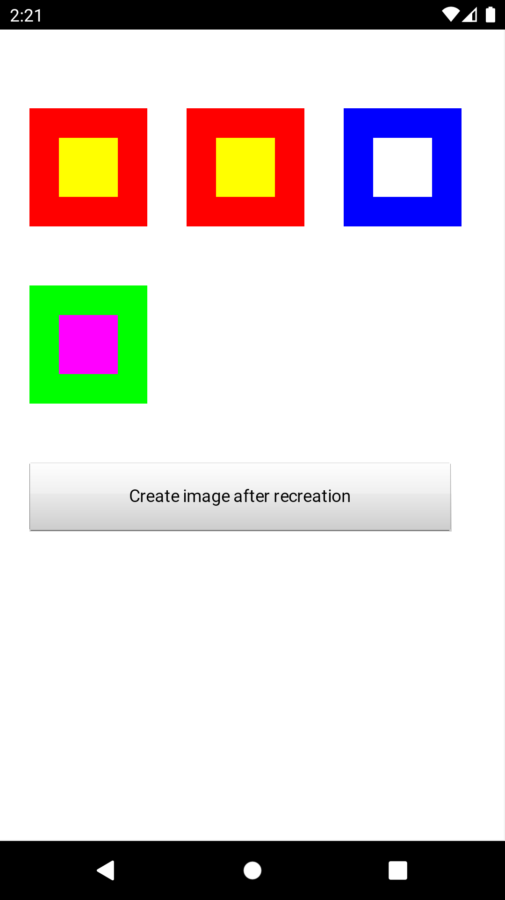
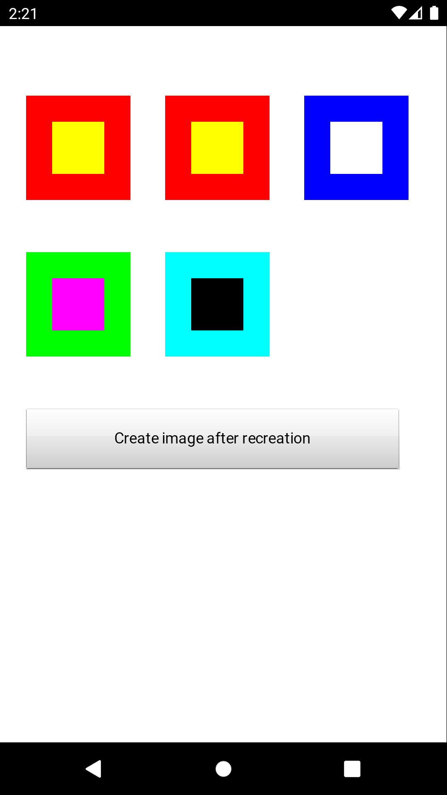
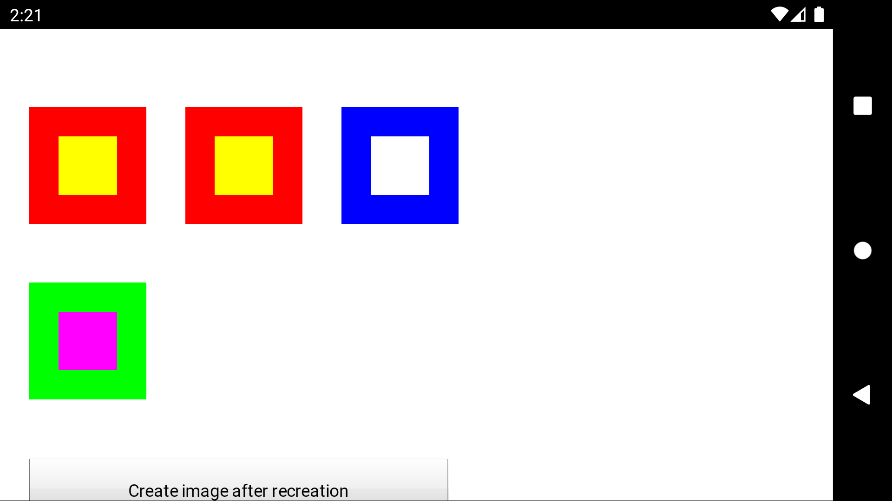

<!--
Copyright (C) 2026 Amalgam Solucoes em TI Ltda

SPDX-License-Identifier: LGPL-2.1-only
-->
# Milestone 4 — default-off API 30 closeout

Resumed from `9542e4d8105f84790a5c3469de2d0fe6d3a1139b` on
`fix/android-skia-egl-surface-lifecycle`. M1–M3 and previously accepted M4
cleanup, recovery, and diagnostic rendering tests were not repeated. No
production source changed and the retained default-off runtime was not rebuilt.

## Artifact identity and environment

| Artifact | SHA-256 |
| --- | --- |
| Default-off ARM64 Release `libtcvm.so` | `c86831b58e4beb0415468d354473cd0f7fc98c09ceb3549abd6d9b89b4316610` |
| Exact customer default-off APK | `842af2c7d984074d09806139252629b626c888e4ccefe570d01f7b704d958af5` |
| Marker-only default-off APK | `9252d1738d7e036884f6216138f029f266f9fc4b0495b221e5c568fd01609779` |
| Existing default-off graphics probe APK | `abb88ebc7790789d0d38cf63ac07834ba947ca660fd9d8b912c9e2b1979c1232` |
| Compatible SDK jar (recorded in M1 provenance) | `79c0f047497e1da65f5b49466f58eb9a04dc876b1bfd571e07cdc5438659a7d7` |
| Disposable `TCUI.tcz` overlay in both customer APKs | `e08519d84906a80e93e1b9e549c992c47fb20ae7ca8e74f78d4f66a18c0dc7fb` |

The source exact and trace APK hashes are `a87bc86037650787ef2f390d135e8b198dd572f5d7693576c4c910b932888406`
and `a500b5c297dcb9b03ed646d1cffb6ca2e5b7ef503d8a0744c77970f021fcbed1`.
Both installed APKs verify with `apksigner`; extracting each embedded ARM64
library reproduces the retained runtime hash above. The probe APK embeds the
same runtime. Its package TCUI archive reproduces the M1 overlay hash. The
temporary SDK build directory had been cleaned, so the jar identity is reused
from the committed M1 provenance record.

Runs used `emulator-5560`, API 30, `arm64-v8a`, hardware-accelerated emulator
graphics. All six `debug.tcvm.*` diagnostic and test-injection properties were
read back as `0` before customer and probe execution.

The Java lifecycle logger's `log.tag.TC_EGL_LIFECYCLE` filter was still `INFO`
during the orientation captures, so it emitted read-only surface callback
records. It was changed to `SUPPRESS` after the capture. No test-injection
property was enabled; a second pixel run with Java logging suppressed was not
started after the 28-minute experiment cutoff.

## Customer permission scenarios

| App / scenario | Result | Evidence |
| --- | --- | --- |
| Exact customer / grant in place | PASS | Settings showed the app's all-files-access page. After granting, app-op was `allow`; Back returned to the same PID (`19531`); no native fatal signal. |
| Exact customer / return denied | PASS | Settings opened with app-op `ignore`; Back returned to the same PID (`20688`); permission remained denied and no native fatal signal. |
| Exact customer / pregranted | PASS | App-op was `allow` before startup; app opened without Settings, stayed on the same live process (`20848`), and produced no native fatal signal. |
| Marker app / grant in place | PASS | Settings return retained PID `19988`; `BEGIN`, `CREATED`, and `DELETED /sdcard/asd` markers; app-op `allow`; no native fatal signal. |
| Marker app / return denied | PASS | Settings return retained PID `20524`; marker reported `Operation not permitted`; app-op remained `ignore`; no native fatal signal. |
| Marker app / pregranted | PASS | No Settings screen; `BEGIN`, `CREATED`, and `DELETED /sdcard/asd`; app-op `allow`; same live PID `20380`; no native fatal signal. |

The test apps remain live after their one-shot filesystem operation, so normal
process termination is not an expected completion condition. `/sdcard/asd` was
absent after each marker operation. Detailed bounded ADB outputs and scenario
JSON remain under `/tmp/codex-android-skia-egl-m4/default-off-customer/`.

## Default-off rendering

The existing graphics probe began in portrait, underwent a system orientation
transition to landscape and back to portrait, then created its cyan image with
the existing UI button. The same process (`20996`) remained foreground and
responsive. Exact RGB pixel counts (PNG RGBA8 decoding, no tolerance) are in
`M4-api30-default-off-pixel-assertions.json`:

| Capture | Red | Yellow | Blue | Green | Magenta | Cyan | Result |
| --- | ---: | ---: | ---: | ---: | ---: | ---: | --- |
| Portrait before | 95256 | 31752 | 47628 | 47628 | 15876 | 0 | PASS |
| Portrait after rotation round-trip | 95256 | 31752 | 47628 | 47628 | 15876 | 0 | PASS |
| After creating a new image | 95256 | 31752 | 47628 | 47628 | 15876 | 47628 | PASS |

The paired portrait captures are both 1080×1920 and have identical counts for
all retained/shared image colors. After the tap, the new cyan image is present
and every prior color count remains unchanged. The landscape capture is
1920×1080; its lower button is clipped by the probe's fixed 600×800 layout in
the shorter viewport and returns in portrait. This is expected layout behavior,
not a rendering discrepancy.

The lifecycle log records surface generations 1–4 and accepted Java-to-native
surface-change callbacks across startup, landscape, and return to portrait. It
contains no `egl.destroy.begin` or `egl.create.madeCurrent` event. Therefore
rendering after the natural orientation transition is PASS, while actual EGL
context replacement remains NOT_RUN as a default-off assertion. No rendering
discrepancy remains unexplained. The captures used the default-off native
runtime and all test hooks were off; the read-only Java logging caveat above is
preserved rather than claiming a logging-suppressed rerun. The separate
diagnostic-enabled five-replacement evidence remains the replacement validation
and was reused without repetition.

## Shared boundary review and limits

All three direct `initSkia()` call sites check its new result: GLES setup,
GLES screen-surface creation, and the shared software screen-surface path. The
software path now propagates failed Skia setup on non-Android builds too; this
is a failure-reporting behavior change, while successful initialization and
renderer selection remain unchanged. No non-Android build or runtime test was
run. Final PR review should compile the affected non-Android software/Skia
configuration and any non-Android GLES/Skia configuration used by CI.

The missing Android UI assets and the unrelated full-harness ADB Back timeout
remain open independent findings; neither was investigated or corrected.
The API 29/30/35/36 matrix and Milestone 5 were not started.
