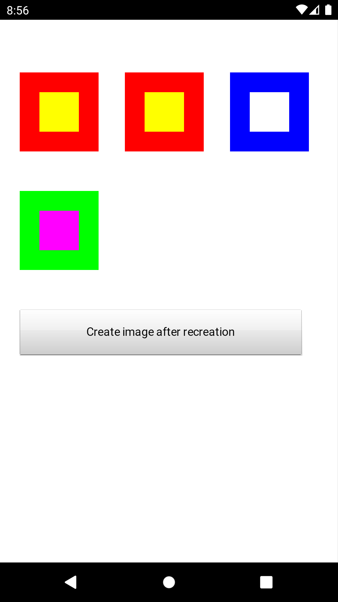
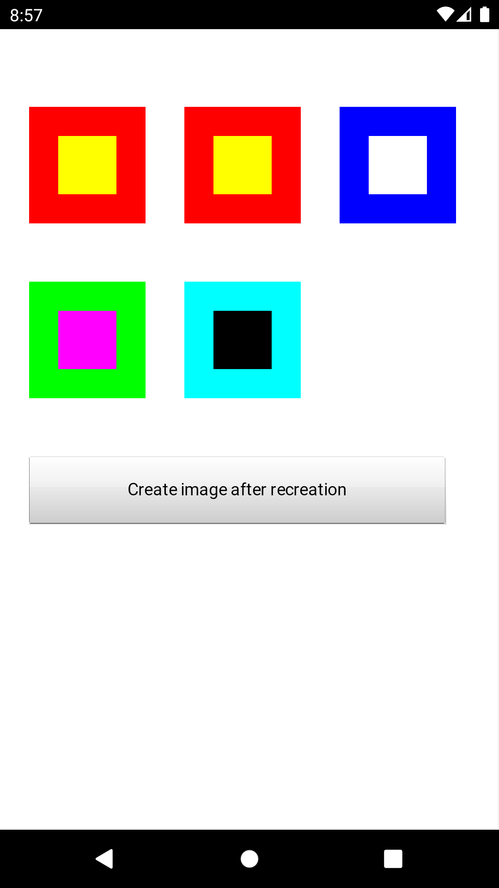

<!--
Copyright (C) 2026 Amalgam Solucoes em TI Ltda

SPDX-License-Identifier: LGPL-2.1-only
-->
# Milestone 4 — resumed API 30 validation

## Scope and artifacts

Resumed from `cfcbcd8e8f8bda672bb9e9350af12593918e5823` on
`fix/android-skia-egl-surface-lifecycle`. M1–M3 were not repeated. The API 30
ARM64 hardware-accelerated emulator was `emulator-5560`; test packages reused
the disposable TCUI overlay. The application-level image probe is
`TotalCrossVM/src/tests/android-skia-egl-lifecycle/Main.java`.

| Runtime | SHA-256 | Build log |
| --- | --- | --- |
| Diagnostics and test hooks enabled ARM64 `libtcvm.so` | `0e9e5e37b79c29db96acce7083f9b29e788832750614fe72c129f5a53c1586b5` | `/tmp/codex-android-skia-egl-m4-recovery-build.log` |
| Default-off ARM64 `libtcvm.so` | `c86831b58e4beb0415468d354473cd0f7fc98c09ceb3549abd6d9b89b4316610` | `/tmp/codex-android-skia-egl-m4-default-off-build.log` |

Both `:app:assembleStandardRelease` builds passed (86 tasks, 13 executed,
73 up-to-date). The graphics probe APK hashes are
`b52b2034f0779c085b78aabffbd1812014a4df95215b2ed7e28fcb05a983fcb0` for the
diagnostic build and `abb88ebc7790789d0d38cf63ac07834ba947ca660fd9d8b912c9e2b1979c1232`
for default-off. The matching binary and APK artifacts remain under
`/tmp/codex-android-skia-egl-m4/resume-apks/`.

## Implementation review and focused checks

- `initSkia()` now reports failure if `GrDirectContext`, `SkSurface`, or its
  canvas cannot be created. GLES and software screen setup propagate that
  result. Android tears down newly initialized EGL state on Skia setup
  failure. Android `updateScreen()` now skips rendering while paused or while
  `screen.surfaceReady` is false.
- All Android `androidDestroyEGL()` call sites were reviewed. Surface
  replacement and final graphics teardown prepare Skia first. Failed Skia
  initialization cleans the current newly-created EGL state before returning.
  The remaining direct EGL cleanup branches occur before Skia resources are
  committed.
- The 5-case C cleanup policy test passed: valid/current, valid/non-current
  rebind, lost context, unavailable/bind failure, and failed binding
  verification.
- Actual test-only `eglMakeCurrent(...NO_CONTEXT)` and
  `eglDestroyContext()` both succeeded before the context-loss event was
  recorded. Skia then selected the abandon path, completed wrapper cleanup,
  and initialized replacement EGL and Skia. The process remained alive.
- A test-only EGL initialization failure initially exposed a second crash:
  `SkCanvas::restoreToCount()` from `skia_shiftScreen()` called by
  `updateScreen()` while the failed surface was not ready. After adding the
  readiness guard, repeating the failure left the process alive. Clearing the
  property and causing another surface callback successfully initialized EGL
  and Skia in that same process. Logs and compact results are in
  `M4-api30-guarded-retry.json` and `/tmp/codex-android-skia-egl-m4/graphics-probe3/`.
- The Skia failure injection clears the just-created local backend surface to
  exercise the null-surface branch, then verifies EGL cleanup and retry. It
  does not claim that the emulator driver naturally returned null from
  `MakeFromBackendRenderTarget()`. The EGL initialization injection returns
  before EGL display allocation; other partial EGL allocation failures were
  not claimed as covered.
- Repeated empty cleanup passed with `debug.tcvm.repeatSkiaCleanup=1`; both
  cleanup calls completed and the process remained alive.

## Rendering and replacements

`Main.java` creates Java-owned colored `Image` objects before transitions,
keeps them in fields, and uses one shared image in two `ImageControl`s. A button
creates a separate cyan/black image after recreation. The test-only force hook
combined with five natural orientation changes caused five consecutive real
EGL teardown/reinitialization cycles in the same process. Each iteration's
ordered record is `skia.cleanup.valid-current.end`, `egl.destroy.begin`,
replacement `egl.create.madeCurrent`, `skia.init.end`. All five screenshots
show exact interior pixel counts for red/yellow, blue/white, green/magenta, and
the post-recreation cyan image. Per-iteration pixels, generations, and
screenshot hashes are in `M4-api30-five-replacements.json`.

The default-off build started the probe, showed visible image content,
returned from Home, and terminated normally. The final default-off screenshot
did not preserve the complete expected layout, so default-off rendering is
partial and has no pixel assertion. A representative pixel-checked rendering
pass was obtained from the diagnostics-enabled build.

## Permission cases and independent findings

The corrected original customer APK's grant-in-place, denied-return, and
pregranted filesystem assertions were not rerun during this resumed interval.
M3's corresponding results belong to the isolated causal candidate, not the
permanent production build. The M4 initial denied harness also remains
incomplete because the existing ADB Back command timed out. The missing
`floatingFrg.png` and `outlined_edit.png` resources and this ADB timeout remain
independent findings; neither was corrected.

No API 29/30/35/36 matrix work or Milestone 5 work was started.
